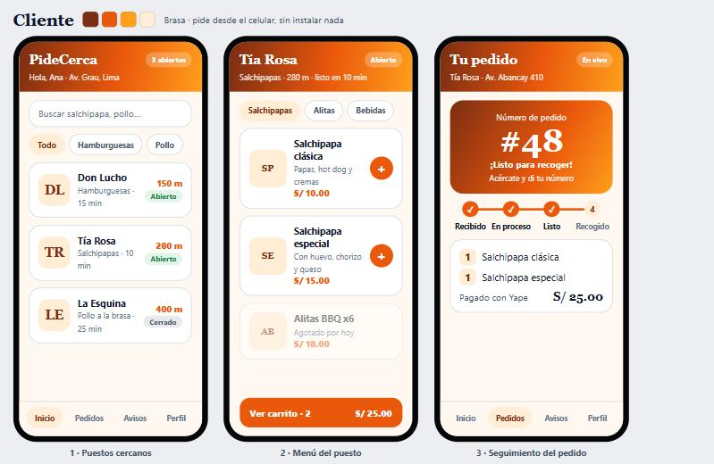
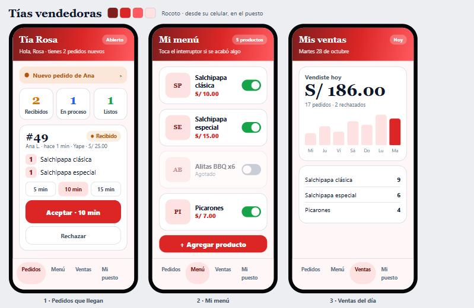
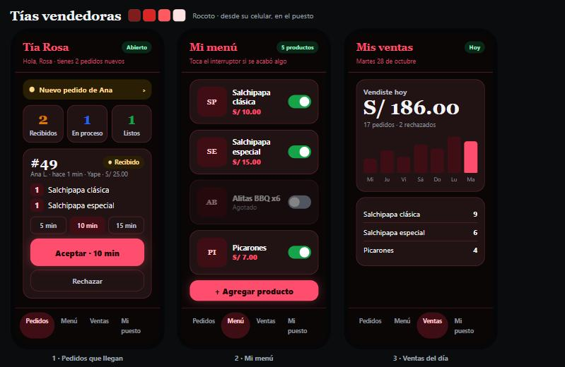
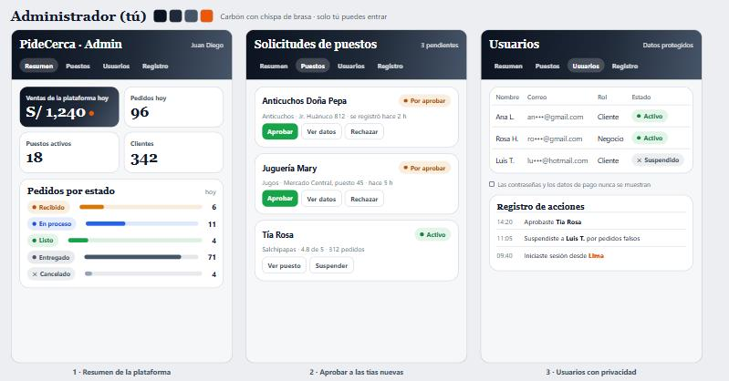

# Diseño de interfaces de PideCerca

Diseño aprobado para la versión web. Cada rol tiene su color, siguiendo el estilo "eléctrico degradado" en modo claro y "neón" en modo oscuro.

## Reglas de facilidad de uso

| Elemento | Regla |
|----------|-------|
| Texto normal | 16 px, nunca menos de 14 px |
| Botones | Al menos 52 px de alto, texto de 16–17 px en negrita |
| Títulos de pantalla | 22–24 px |
| Números importantes | 32–44 px (número de pedido, ventas) |
| Letra | Una sola familia del sistema, sin descargas |
| Acción principal | Una por pantalla, en el color del rol |
| Íconos | Siempre acompañados de texto |
| Navegación | Máximo 4 pestañas |
| Contraste | Alto, legible al sol |

## Colores de estado del pedido

| Estado | Color |
|--------|-------|
| Recibido | Ámbar |
| En proceso | Azul |
| Listo | Verde |
| Entregado | Gris |
| Cancelado | Gris con ✕ |

## Cliente · Brasa

Puestos cercanos, menú del puesto y seguimiento del pedido.

## Negocio · Rocoto

Pedidos que llegan, mi menú y ventas del día.

Modo oscuro:

## Administrador · Carbón

Resumen de la plataforma, solicitudes de puestos y usuarios con privacidad.

